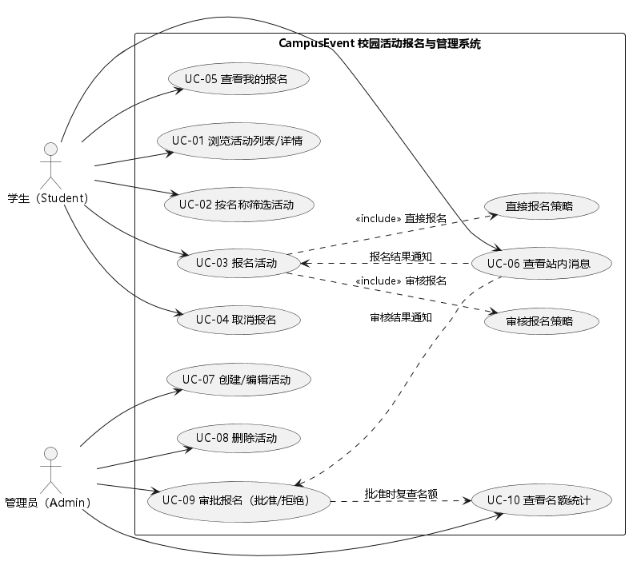

# 实验二 · 用例说明

## 1. 用例图

源文件：`uml/usecase.puml`（PlantUML，可用 `plantuml.jar` 重新渲染）

## 2. 参与者与用例清单

| 编号 | 用例 | 参与者 | 触发条件 | 结果 |
| --- | --- | --- | --- | --- |
| UC-01 | 浏览活动列表/详情 | 学生、管理员 | 进入系统 | 看到活动信息与名额统计 |
| UC-02 | 按名称筛选活动 | 学生 | 输入关键字 | 列表只显示匹配活动 |
| UC-03 | 报名活动 | 学生 | 点击“报名” | 生成报名记录（已通过或待审核）+ 站内通知 |
| UC-04 | 取消报名 | 学生 | 在“我的报名”点击取消 | 状态变为已取消，统计同步 |
| UC-05 | 查看我的报名 | 学生 | 进入“我的报名” | 列出全部报名与状态 |
| UC-06 | 查看站内消息 | 学生 | 进入“站内消息” | 看到报名/审核结果通知，可标记已读 |
| UC-07 | 创建/编辑活动 | 管理员 | 填写活动表单 | 活动入库可被学生报名 |
| UC-08 | 删除活动 | 管理员 | 点击删除 | 无报名记录时删除成功，否则拒绝并提示 |
| UC-09 | 审批报名 | 管理员 | 在“待审核审批”点击批准/拒绝 | 状态变为已通过/已拒绝 + 站内通知 |
| UC-10 | 查看名额统计 | 管理员 | 进入活动管理/审批页 | 看到已通过、待审核、剩余名额 |

## 3. 关键用例规约

### UC-03 报名活动

| 项 | 内容 |
| --- | --- |
| 参与者 | 学生（Student） |
| 前置条件 | 已用演示账号登录；活动存在且尚未开始 |
| 后置条件 | 成功：新增一条报名记录（直接报名=已通过，审核型=待审核），并写入一条站内消息；失败：不产生任何脏数据 |
| 主流程 | 1. 学生打开活动列表/详情，点击“报名” 2. 系统校验活动存在、未开始 3. 系统校验是否已有有效报名（待审核/已通过） 4. 系统按 `policy_type` 取策略，策略返回目标状态 5. 若策略要求即时校验名额，检查“已通过数 < 上限” 6. 写入报名记录并提交事务 7. 发布 `SUBMITTED` 事件，观察者写站内消息 8. 页面提示“报名已提交，当前状态：…” |
| 异常流 | 3a. 已有有效报名 → 提示“不能重复报名”，不写库（C3） 5a. 直接报名且名额已满 → 提示“名额已满”，不写库（C4） 2a. 活动已开始 → 提示“活动已经开始”（X1） 7a. 通知写入失败 → 报名仍成功，失败写入 `notification_failures`（X7） |
| 业务规则 | B.2-1、B.2-2、B.2-3、B.2-4、B.2-5 |

### UC-09 审批报名

| 项 | 内容 |
| --- | --- |
| 参与者 | 管理员（Admin） |
| 前置条件 | 存在状态为“待审核”的报名；操作人角色为 admin |
| 后置条件 | 成功：状态变为“已通过”或“已拒绝”，写入站内消息；失败：状态保持“待审核” |
| 主流程 | 1. 管理员打开“待审核审批”列表 2. 选择一条申请，点击“批准”或“拒绝”（拒绝可填原因） 3. 系统校验操作人是管理员 4. 校验报名状态必须是“待审核” 5. 批准时复核名额：已通过数 ≥ 上限 → 拒绝本次批准 6. 更新状态、提交事务 7. 发布 APPROVED / REJECTED 事件，写站内消息 8. 列表刷新，统计数据同步变化 |
| 异常流 | 3a. 非管理员 → `PermissionDeniedError`（X4） 4a. 状态不是待审核（已批准/已拒绝/已取消）→ `InvalidStateTransitionError`（X3b） 5a. 名额已满 → `CapacityExceededError`，报名仍为待审核（C8） |
| 业务规则 | B.2-2、B.2-3、B.2-6 |
