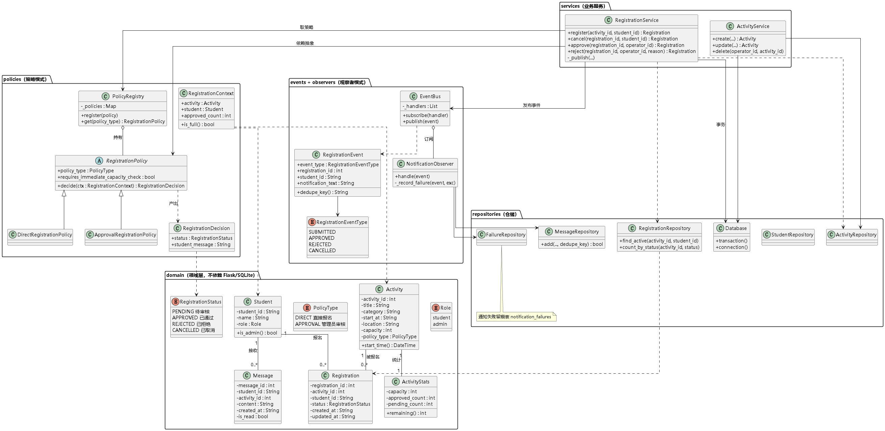

# 实验二 · UML 类图与职责说明

## 1. 类图

源文件 `uml/class-diagram.puml`。图中虚线表示依赖，实线/三角箭头表示关联与继承。

## 2. 包的划分与依赖方向

| 层 | 包 | 职责 | 允许依赖 |
| --- | --- | --- | --- |
| 领域层 | `domain` | 实体、状态枚举、业务异常、时间工具 | 不依赖 Flask / SQLite / 服务层 |
| 规则层 | `policies` | 报名策略抽象、两种实现、注册表 | 仅依赖 `domain` |
| 事件层 | `events` / `observers` | 事件定义、事件总线、站内通知观察者 | `observers` 依赖 `events` + 仓储 |
| 仓储层 | `repositories` | SQLite 读写与页面读模型 | `domain` + `sqlite3` |
| 服务层 | `services` | 事务边界与业务规则编排 | 依赖策略、事件、仓储 |
| 表现层 | `web` | Flask 蓝图、路由、模板 | 只调用服务层与读模型 |

依赖方向始终指向内层：`web → services → policies/events/repositories → domain`。
`domain` 里的类不认识数据库，因此服务层可以被测试直接驱动（36 条用例都不经过浏览器）。

## 3. 主要类的职责

| 类 | 职责（一句话） | 不负责什么 |
| --- | --- | --- |
| `Student` | 表示账号与角色 | 不做权限判断（判断在服务层） |
| `Activity` | 活动信息与容量/报名方式 | 不判断名额，不做持久化 |
| `Registration` | 一条报名记录及其状态 | 不决定状态怎么变（由策略和服务决定） |
| `Message` | 站内消息 | 不知道消息由哪个事件产生 |
| `ActivityStats` | 名额统计视图（已通过/待审核/剩余） | 不做查询（由读模型填充） |
| `RegistrationPolicy`（抽象） | 回答“提交报名后进入哪个状态” | 不查库、不判名额、不发通知 |
| `DirectRegistrationPolicy` | 直接报名 → 已通过，要求提交即校验名额 | — |
| `ApprovalRegistrationPolicy` | 审核型 → 待审核，提交不校验名额 | 不负责批准 |
| `PolicyRegistry` | `policy_type` → 策略对象 | 不参与业务判断 |
| `RegistrationService` | 报名/取消/审批的唯一入口；事务边界；公共规则（时间、重复、名额） | 不决定状态迁移（委托策略） |
| `ActivityService` | 活动增删改与字段校验 | 不处理报名 |
| `EventBus` | 订阅与发布，隔离观察者异常 | 不做持久化，不保证投递顺序之外的东西 |
| `RegistrationEvent` | 已发生事实 + 通知文案 + 幂等键 | 不含业务规则 |
| `NotificationObserver` | 把事件写成站内消息；失败留痕 | 不回滚业务事务 |
| `Database` | 连接与显式事务 | 不含 SQL 语义 |
| `*Repository` | 单表读写 | 不含业务规则 |
| `queries` | 页面读模型（活动+统计+我的状态） | 不写入 |

## 4. 关系说明（为什么这样连）

1. **Student / Activity / Registration 三元关联**：一条报名唯一确定“谁报了哪个活动”，
   因此 `Registration` 同时持有 `activity_id` 与 `student_id`，并在数据库层建立外键。
2. **`RegistrationService → RegistrationPolicy` 是依赖 + 抽象**：服务只依赖接口，
   具体实现由 `PolicyRegistry` 注入，新增报名方式时服务代码不变（见决策报告第 3 节）。
3. **`EventBus o-- NotificationObserver`（聚合）**：总线持有观察者列表，
   观察者可随时增删；未来加“邮件通知观察者”只需再 `subscribe` 一次。
4. **`NotificationObserver → MessageRepository / FailureRepository`**：观察者自己决定
   成功写消息表、失败写留痕表，业务服务完全不感知通知渠道。
5. **`RegistrationRepository → Registration`**：仓储负责把行映射为实体，
   保证实体在服务层是“纯数据”，便于单元测试。

## 5. 与需求检查表（B.3）的对照

| 检查项 | 是否满足 | 证据 |
| --- | --- | --- |
| 类图体现活动、学生、报名记录、报名业务、通知职责 | 是 | 五类职责 + 两个服务 + 观察者 |
| 至少一个策略接口与两种实现，并说明策略选择与公共规则位置 | 是 | `policies/base.py`、`implementations.py`；决策报告第 2 节 |
| 通知通过观察者或等价事件机制解耦 | 是 | `events/event_bus.py` + `observers/` |
| 至少两张时序图（报名、审批） | 是 | `uml/sequence-register.png`、`uml/sequence-approve.png` |
| 明确名额超限、重复报名、取消、审批冲突 | 是 | C3/C4/C8/C9 测试 + 异常流规约 |
| 提供设计取舍说明（成本与扩展） | 是 | 决策报告第 5、6 节 |
