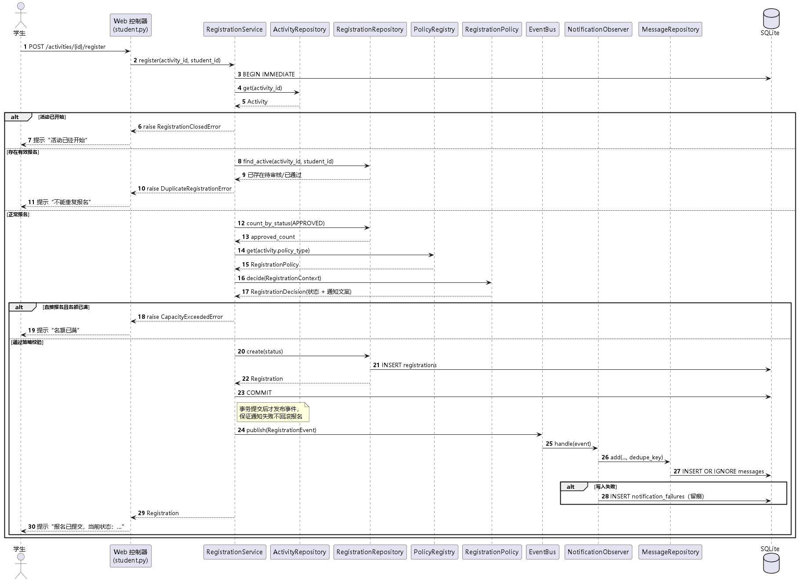
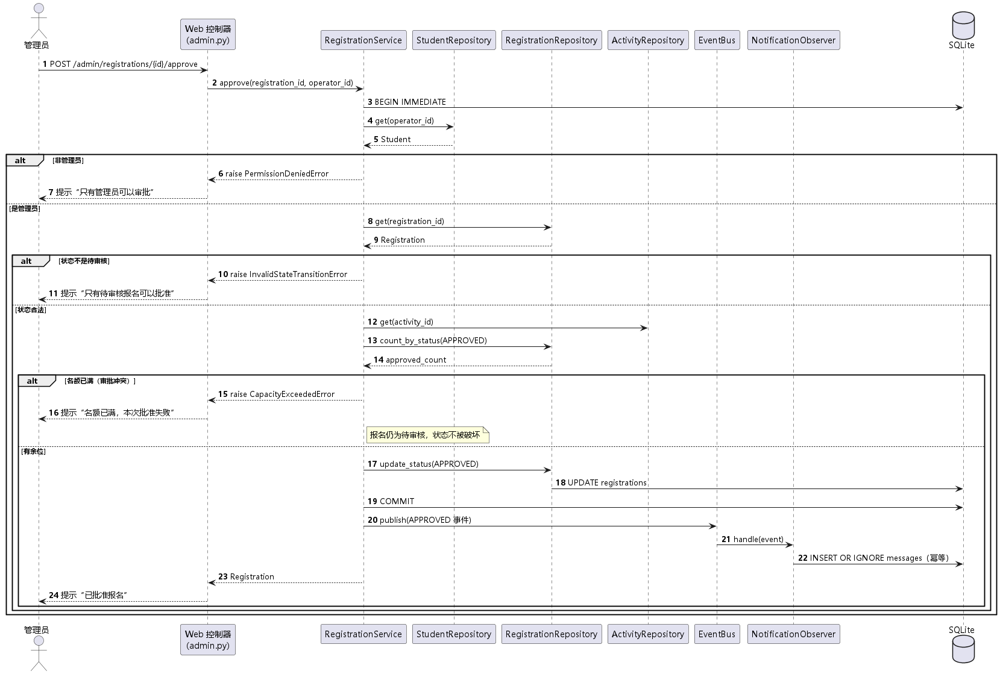

# 实验二 · 关键交互时序图

## 1. 报名时序（直接报名与审核型共用一个入口）

源文件 `uml/sequence-register.puml`。

要点：

1. **一个入口，两种结果**：`RegistrationService.register()` 不认识“活动类型”，
   只把 `RegistrationContext` 交给 `PolicyRegistry` 取到的策略，由策略返回目标状态。
2. **名额检查位置**：服务层统一判断。直接报名的策略声明
   `requires_immediate_capacity_check = True`，所以满员时在提交阶段就被拒绝（C4）；
   审核型策略声明为 `False`，允许满员后继续排队（X9）。
3. **事务先提交、事件后发布**：`COMMIT` 完成后再 `publish`，
   因此通知写失败不会回滚报名（X7），失败会写入 `notification_failures`。
4. **幂等**：观察者用 `dedupe_key = 事件类型:报名ID` 调
   `INSERT OR IGNORE`，重复发布同一事件只留一条消息（X6）。

## 2. 审批时序

源文件 `uml/sequence-approve.puml`。

要点：

1. **先校验身份**：非管理员直接 `PermissionDeniedError`，避免越权审批（X4）。
2. **再校验状态**：只有“待审核”可以审批，已通过/已拒绝/已取消都会被拒绝（X3b）。
3. **最后校验名额**：批准前重新统计“已通过”人数，满员则批准失败，
   此时报名仍保持“待审核”，不产生超员数据（C8）——这就是“审批冲突”的处理方式。
4. 批准/拒绝都会发布事件并写站内消息，学生端在“站内消息”中可见（C6/C7）。
